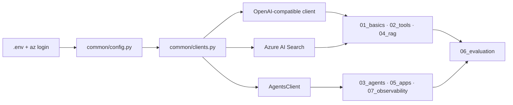

<!-- jr-brand:start -->
<p align="center">
  <a href="https://jannikreinhard.com/">
    
  </a>
</p>
<p align="center">
  <a href="https://jannikreinhard.com/">Website</a> ·
  <a href="https://www.linkedin.com/in/jannik-r/">LinkedIn</a> ·
  <a href="https://x.com/jannik_reinhard">X</a> ·
  <a href="https://www.youtube.com/@jannikreinhard">YouTube</a>
</p>
<!-- jr-brand:end -->

# Microsoft Foundry examples

**Type:** Examples and labs · **Status:** Community project

## Overview

37 Python examples for Microsoft Foundry: model calls, tools, agents, retrieval, evaluation and tracing.

Azure AI Foundry | Python 3.11 | gpt-5.6-sol | Agents · RAG · Evaluation · Tracing

A catalog of small, self-contained Python examples for Azure AI Foundry — from a plain
chat completion through tools, agents and RAG to evaluation, tracing and the things that
sit between a prototype and production.

Every file runs on its own, explains in its docstring **why** something is done that way,
and is short enough to read in one go.

```bash
python 01_basics/01_chat_completion.py
```

Two things make this different from a quickstart:

- **All 37 examples were executed against a live Foundry project** (Sweden Central,
  Python 3.11) — including Azure AI Search, Grounding with Bing Search and Application
  Insights. The pinned versions in `requirements.txt` are the tested ones.
- **The comments describe errors that actually happened during those runs**, not errors
  that could theoretically happen. Where an SDK is broken, it says so and shows the
  workaround.

> The code comments and docstrings are in German. The README, structure and error
> messages are English. A German version of this README is in
> [`README.de.md`](README.de.md).

<a id="prerequisites"></a>

## Requirements

| | |
|---|---|
| Foundry resource | `Microsoft.CognitiveServices/accounts`, kind `AIServices`, with a **managed identity** and **`allowProjectManagement: true`** |
| Foundry project | Child resource; provides the endpoint `https://<name>.services.ai.azure.com/api/projects/<project>` |
| Chat deployment | `gpt-5.6-sol` (the deployment name is yours to pick — it goes into `.env`) |
| Agent deployment | `gpt-4o` — see [Which model where](#which-model-where) |
| Embedding deployment | `text-embedding-3-small`, only needed for RAG |
| Roles on the resource | **Foundry User** (role ID `53ca6127-db72-4b80-b1b0-d745d6d5456d`) and **Cognitive Services OpenAI User** |

Optional, each linked as a *connection* in the project: Azure AI Search (RAG), Grounding
with Bing Search, Application Insights (tracing). Setup notes for all three are in
[Optional building blocks](#optional-building-blocks).

Authentication is keyless throughout: `DefaultAzureCredential` picks up `az login`
locally, a managed identity in Azure and a service principal in CI — no code change.

## Quickstart

```bash
git clone https://github.com/JayRHa/foundry-examples.git
cd foundry-examples

python3.11 -m venv .venv && source .venv/bin/activate
pip install -r requirements.txt

cp .env.example .env      # add your project endpoint and deployment names
az login                  # no API key needed

python 09_ops/01_inspect_project.py   # verify the connection first
python 01_basics/01_chat_completion.py
```

## How It Works



One configuration source, one place where clients are built, and every example is a leaf.
No example reads `os.environ` itself.

## The Catalog

### `01_basics/` — model calls

| File | Topic |
|---|---|
| `01_chat_completion.py` | The basic call, client from the project, token accounting |
| `02_streaming.py` | Token streaming including usage at the end (`stream_options`) |
| `03_structured_output.py` | Guaranteed valid JSON against a Pydantic schema |
| `04_vision_multimodal.py` | Images as base64 `data:` URLs, `detail` as the cost lever |
| `05_embeddings.py` | Batching, shortened dimensions, similarity |
| `06_model_catalog.py` | Llama/Mistral/Phi/Cohere through the same API — and where the parameters diverge |
| `07_responses_api.py` | Server-side conversation state instead of history in the request |
| `08_reasoning_model.py` | `reasoning_effort` compared (none/low/medium/high) with time and reasoning tokens |

### `02_tools/` — function calling

| File | Topic |
|---|---|
| `01_function_calling.py` | The tool loop by hand — worth building once |
| `02_tool_registry.py` | Schema from type hints, parallel execution (4 calls in 1s instead of 4s) |
| `03_mcp_via_responses.py` | Wiring up an MCP server, approval modes, security notes |

### `03_agents/` — Azure AI Agent Service

| File | Topic |
|---|---|
| `01_hello_agent.py` | Agent / thread / run — the core model |
| `02_agent_function_tools.py` | Own functions as tools, guards in code rather than in the prompt |
| `03_code_interpreter.py` | Data analysis in the sandbox, retrieving generated PNGs |
| `04_file_search_rag.py` | RAG without your own pipeline (vector store), with citations |
| `05_streaming_events.py` | Event handler: seeing what the agent is doing right now |
| `06_bing_grounding.py` | Current facts with mandatory source attribution |
| `07_connected_agents.py` | Multi-agent: an orchestrator delegating to specialists |
| `08_openapi_tool.py` | Wiring an existing REST API with no glue code (calls the real Open-Meteo) |
| `09_mcp_tool.py` | MCP in the Agent Service including the approval workflow |
| `10_lifecycle.py` | Agents and threads across process boundaries (CLI) |

### `04_rag/` — your own search index

| File | Topic |
|---|---|
| `01_build_index.py` | Heading-aware chunking, embeddings, HNSW + semantic + **vectorizer** |
| `02_hybrid_search.py` | BM25 + vector + reranking, numbered citations mapped back to sources |
| `03_agent_search_tool.py` | The same index as an agent tool |

### `05_apps/` — applications

| File | Topic |
|---|---|
| `fastapi_chat_api.py` | Chat API with SSE streaming, thread mapping, test page (`PORT=8077 python ...`) |
| `streamlit_chat.py` | Prototype UI with correct caching and session state |
| `cli_agent.py` | Terminal assistant with file access and a path guard |

### `06_evaluation/` — measuring quality

| File | Topic |
|---|---|
| `01_evaluators.py` | Groundedness/relevance plus a custom rule-based evaluator |
| `02_batch_evaluate.py` | A/B of two prompt versions, upload to the portal |
| `03_agent_evaluation.py` | Intent resolution, tool call accuracy, task adherence |

### `07_observability/` — tracing

| File | Topic |
|---|---|
| `01_tracing_console.py` | Inspecting OpenTelemetry spans locally |
| `02_tracing_app_insights.py` | Traces in Azure Monitor plus three KQL queries verified against real data |

### `08_agent_framework/` — Microsoft Agent Framework (optional)

| File | Topic |
|---|---|
| `01_basics.py` | Agent as a local object, tools as Python functions, session, streaming |
| `02_workflow.py` | A fixed sequence as a graph instead of free delegation |

Separate requirements file, see [`08_agent_framework/README.md`](08_agent_framework/README.md).

### `09_ops/` — operations

| File | Topic |
|---|---|
| `01_inspect_project.py` | Inventory: deployments, connections, agents |
| `02_prompt_templates.py` | Prompts as versioned `.prompty` files |
| `03_production_hardening.py` | 429 backoff with `retry-after-ms`, content filter, timeouts, cost accounting |

## Which Model Where

This repo uses **`gpt-5.6-sol` everywhere it works**. There is exactly one place where it
does not, and that is not a matter of taste:

| Where | Deployment | Reason |
|---|---|---|
| Chat Completions, Responses API, tools, RAG answers, prompt templates, evaluation judge, Agent Framework | **`gpt-5.6-sol`** | fully supported |
| Classic Agent Service (`03_agents/`, `04_rag/03`, `05_apps/`, `06_evaluation/03`, `07_observability/`) | **`gpt-4o`** | see below |
| Embeddings | `text-embedding-3-small` | there is no GPT-5 embedding model |
| `01_basics/06_model_catalog.py` (second call) | `llama-3.3-70b` | the point of that example is a non-OpenAI model |

**The classic Agent Service is the bottleneck, not the model.** New models hit two
independent walls there.

*Wall 1 — `top_p`.* The Agent Service sets a `top_p` internally on every run. The newest
models reject the parameter:

```
{'code': 'invalid_prompt', 'message': "Unsupported parameter: 'top_p' is not supported with this model."}
```

It cannot be suppressed — not through `create_agent(top_p=...)`, not through
`runs.create(top_p=...)`, and no newer API version of the Agent Service helps.

*Wall 2 — tool compatibility.* Even the GPT-5 models that clear the first wall only
support a subset of tools there. `gpt-5-mini` says so plainly, while `gpt-5.4` answers the
same cases with an unhelpful `server_error: Sorry, something went wrong.`:

```
The model 'gpt-5-mini' cannot be used with the following tools: openapi.
This model only supports Responses API compatible tools.
```

Tested, Agent Service:

| Model | Run completes | Code Interpreter / File Search / MCP | OpenAPI / Bing / Connected Agents / AI Search |
|---|---|---|---|
| `gpt-5.6-sol` | no (`top_p`) | — | — |
| `gpt-5.5` | no (`top_p`) | — | — |
| `gpt-5.4` | yes | yes | no (`server_error`) |
| `gpt-5-mini` | yes (no `temperature`) | yes | no (clear message) |
| **`gpt-4o`** | **yes** | **yes** | **yes** |

Hence `AGENT_MODEL_DEPLOYMENT_NAME=gpt-4o`. If your project only uses Code Interpreter,
File Search or MCP, you can put `gpt-5.4` there.

**What this means for new projects:** the classic Agent Service is the legacy surface.
For new models the path leads through the Responses API or the Agent Framework
(`08_agent_framework/`), where `gpt-5.6-sol` runs without restrictions.

## What Changes With the GPT-5 Family

| Before | Now | Otherwise |
|---|---|---|
| `max_tokens=400` | `max_completion_tokens=4000` | `Unsupported parameter: 'max_tokens' ... Use 'max_completion_tokens' instead` |
| `temperature=0` | omit it | `Unsupported value: 'temperature' does not support 0 ... Only the default (1)` |
| `top_p=0.9` | omit it | `Unsupported parameter: 'top_p' is not supported with this model` |
| — | `reasoning_effort="none"\|"low"\|"medium"\|"high"` | the actual cost lever, see `01_basics/08` |
| `"role": "system"` | `"role": "developer"` | both still work; `developer` is the intended form |

Two consequences that are easy to miss:

- **`max_completion_tokens` also covers the invisible reasoning tokens.** Set it too low
  and you get an *empty* answer with `finish_reason="length"` — paid for, with no result.
  That is why the budgets here are generous (2000–8000) instead of the earlier 150–500.
- **`temperature=0` as a determinism tool is gone.** Reproducibility now comes from
  structured outputs (`01_basics/03`), tight schemas and precise prompts.

Two SDKs need an explicit switch:

```python
# azure-ai-evaluation: without the flag the judge sends max_tokens internally
GroundednessEvaluator(model_config=config, is_reasoning_model=True)

# azure-ai-inference: only knows max_completion_tokens as a pass-through field
client.complete(messages=..., model_extras={"max_completion_tokens": 3000})
```

## Which Path For What

**A single model call with your own logic around it** → `01_basics/` + `02_tools/`
Full control, no state in the service, easiest to test. The default as long as it suffices.

**State, built-in tools, little code of your own** → `03_agents/`
Threads, file search, code interpreter, Bing, OpenAPI — all server-side. The fastest route
to an assistant, at the price of less control over the details.

**Portable, complex orchestration** → `08_agent_framework/`
When the flow is a graph with conditions and checkpoints, or when the model provider
should stay swappable.

**RAG:** try `03_agents/04_file_search_rag.py` first. If that is not enough — custom
chunking, metadata filters, a large corpus — go to `04_rag/`.

## SDK Pitfalls That Cost the Most Time

All of these actually occurred here and are commented at the relevant place in the code.

**1. `azure-ai-projects` 2.x is a break from 1.x.**
In 2.x `project.agents` is no longer the classic AgentsClient but the new declarative
agent-version API:

```
AttributeError: 'AgentsOperations' object has no attribute 'create_agent'
```

Fix (in `common/clients.py`): build the `AgentsClient` directly from the separate
`azure-ai-agents` package instead of going through the project. Likewise
`get_openai_client()` no longer takes `api_version` in 2.x —
`TypeError: OpenAI.__init__() got an unexpected keyword argument 'api_version'`.

**2. The project-scoped `/openai/v1` does not serve embeddings.**
In 2.x `get_openai_client()` points at `{endpoint}/api/projects/{project}/openai/v1`. Chat
and Responses work there, `/embeddings` answers with a bare `404` and no explanation. The
*resource* endpoint (`{endpoint}/openai/v1`) serves both, so `common/clients.py` rewrites
the `base_url`.

**3. Tracing without `azure-core-tracing-opentelemetry` shows only your own spans.**
Instrumentation reports success, yet not a single `gen_ai.*` span appears. The bridge is
missing:

```python
from azure.core.settings import settings as azure_settings
azure_settings.tracing_implementation = "opentelemetry"
```

**4. `AzureAISearchTool` needs an integrated vectorizer in the index.**

```
Query type vector_semantic_hybrid requires a vector field with integrated vectorizer
```

A vector field alone is not enough — the search service must be able to embed the query
itself. `01_build_index.py` creates an `AzureOpenAIVectorizer` for that; the search
service's managed identity needs **Cognitive Services OpenAI User** on the Foundry
resource.

**5. `AIAgentConverter` fits neither client generation.**
It expects an object with `.agents`, and `.agents` has to be the classic AgentsClient. The
AgentsClient itself has no `.agents`, and `AIProjectClient` 2.x exposes something else
under `.agents`:

```
'AgentsClient' object has no attribute 'agents'       # passing the AgentsClient
'AgentsOperations' object has no attribute 'runs'     # passing AIProjectClient 2.x
```

`06_evaluation/03_agent_evaluation.py` solves it with a two-line adapter.

**6. `TaskAdherenceEvaluator` scores incorrectly in azure-ai-evaluation 1.18.5.**
It reproducibly returns `score=0.0` alongside a rationale that explicitly describes the
behaviour as correct. The input payload is complete — the bug is in the evaluator. Rule of
thumb: validate an evaluator against cases with known outcomes before wiring it up as a
gate in a pipeline, otherwise a broken metric either blocks your deployment or waves it
through.

## Optional Building Blocks

### Azure AI Search (for `04_rag/`)

The free tier is enough for these examples, semantic ranker included.

- Set auth to `aadOrApiKey`, otherwise Entra ID does not apply.
- To yourself: **Search Index Data Contributor** + **Search Service Contributor**.
- To the managed identity of both the Foundry resource *and* the project: **Search Index Data Reader**.
- To the search service's managed identity: **Cognitive Services OpenAI User** on the Foundry resource (for the vectorizer).
- Connection in the project: category `CognitiveSearch`, `authType: AAD`.

### Grounding with Bing Search (for `03_agents/06`)

- Resource: `Microsoft.Bing/accounts`, kind `Bing.Grounding`, SKU `G1`, region `global`.
- **MSDN and sponsorship subscriptions cannot buy the SKU** (`SkuNotEligible`) — use a
  pay-as-you-go subscription instead. Cross-subscription works.
- Connection: category `GroundingWithBingSearch`, `authType: ApiKey` (AAD is rejected),
  target `https://api.bing.microsoft.com/`.
- Wait ~30 seconds after creating it: before that you get a misleading `401 Unauthorized`.

### Application Insights (for `07_observability/02`)

A Log Analytics workspace plus an Application Insights component, then linked into the
project as a connection of category `AppInsights`. After that the code fetches the
connection string from the project itself — no second place to configure.

## Conventions

- **One configuration source.** No example reads `os.environ` itself; everything goes
  through `common/config.py`.
- **No keys.** `DefaultAzureCredential` everywhere; a key path exists only as an emergency
  exit.
- **A `sys.path` shim at the top of every file.** That is what lets the scripts run
  directly via `python <folder>/<file>.py` even though the folders start with digits and
  therefore cannot be Python packages.
- **Cleanup in `finally`.** The examples delete their agents and threads. In production
  you do *not* do that — see `03_agents/10_lifecycle.py` and `05_apps/fastapi_chat_api.py`.
- **Print model output with `markup=False`.** Otherwise `rich` eats square brackets — an
  answer carrying the citation marker `[handbuch.md#2]` shows up without the citation and
  you go looking for the bug in the prompt instead of in the console.

## Troubleshooting

| Symptom | Cause |
|---|---|
| `DefaultAzureCredential failed` | `az login` missing or wrong tenant (`az login --tenant <id>`) |
| `404 DeploymentNotFound` | `MODEL_DEPLOYMENT_NAME` is the model name rather than the deployment name → `09_ops/01` |
| `403 PermissionDenied` | The **Foundry User** role on the resource is missing |
| `'AgentsOperations' object has no attribute 'create_agent'` | See pitfall 1 |
| `OpenAI.__init__() got an unexpected keyword argument 'api_version'` | See pitfall 1 |
| No `gen_ai.*` spans in the trace | See pitfall 3 |
| `requires a vector field with integrated vectorizer` | See pitfall 4 |
| `404` on `embeddings.create` | See pitfall 2 |
| `'AgentsOperations' object has no attribute 'runs'` | See pitfall 5 |
| `Unsupported parameter: 'top_p'` in an agent run | Agent model too new → `AGENT_MODEL_DEPLOYMENT_NAME=gpt-4o` |
| `server_error: Sorry, something went wrong.` in an agent run | GPT-5 model plus a server-side tool (OpenAPI/Bing/Connected/AI Search) → `gpt-4o` |
| `Unsupported parameter: 'max_tokens'` | GPT-5 family: use `max_completion_tokens`; for evaluators pass `is_reasoning_model=True` |
| `Unsupported value: 'temperature'` | The GPT-5 family only accepts the default — drop the argument |
| Empty answer with `finish_reason="length"` | `max_completion_tokens` too small: the budget also covers reasoning tokens |
| `ServiceModelDeprecating` when deploying | Model version retired: `az cognitiveservices model list -l <region>` |
| `429` | Quota exhausted → `09_ops/03_production_hardening.py` |
| Port 8000 in use | `PORT=8077 python 05_apps/fastapi_chat_api.py` |

## Cost

Every example is kept small (a few hundred tokens per run). The more expensive ones are
`03_agents/06_bing_grounding.py` (a search fee per call),
`06_evaluation/02_batch_evaluate.py` (one judge call per row *and* evaluator) and anything
using the code interpreter (sandbox runtime). Cleanup happens in `finally`, except in
`10_lifecycle.py` and `fastapi_chat_api.py`, which deliberately leave their agents in
place.

## License

MIT License. See [LICENSE](LICENSE).

<!-- jr-brand-footer:start -->
---

[Articles and guides](https://jannikreinhard.com/) · [Repository index](https://github.com/JayRHa/.github/blob/main/REPOSITORIES.md)
<!-- jr-brand-footer:end -->
